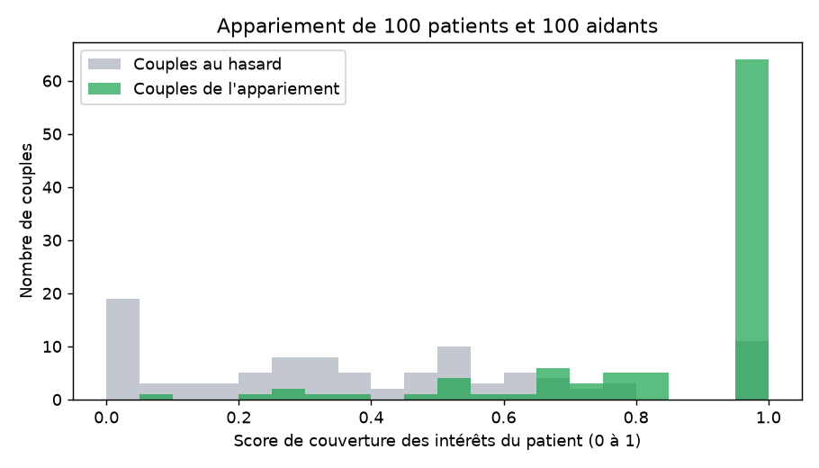
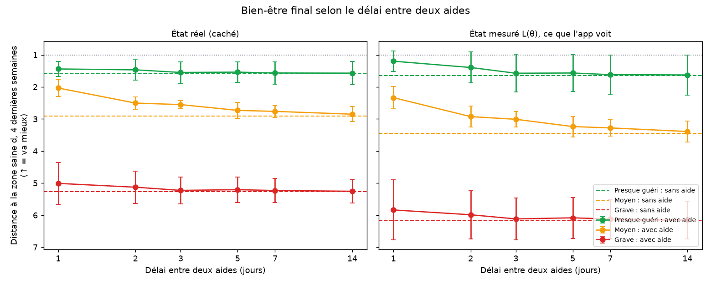
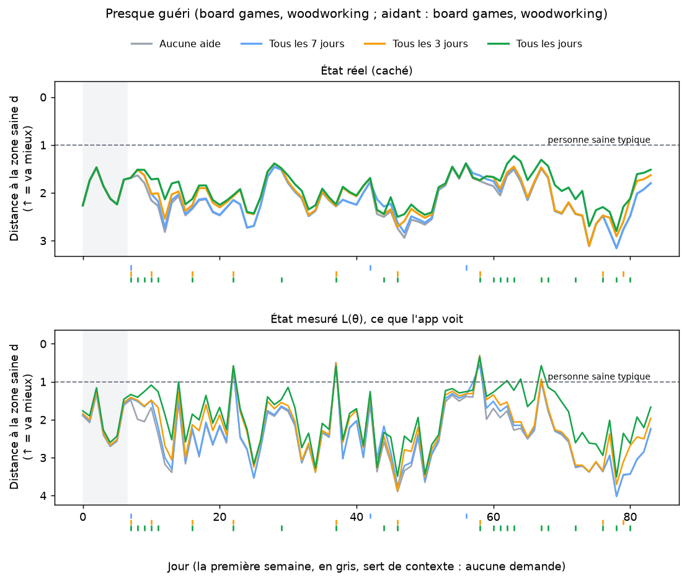
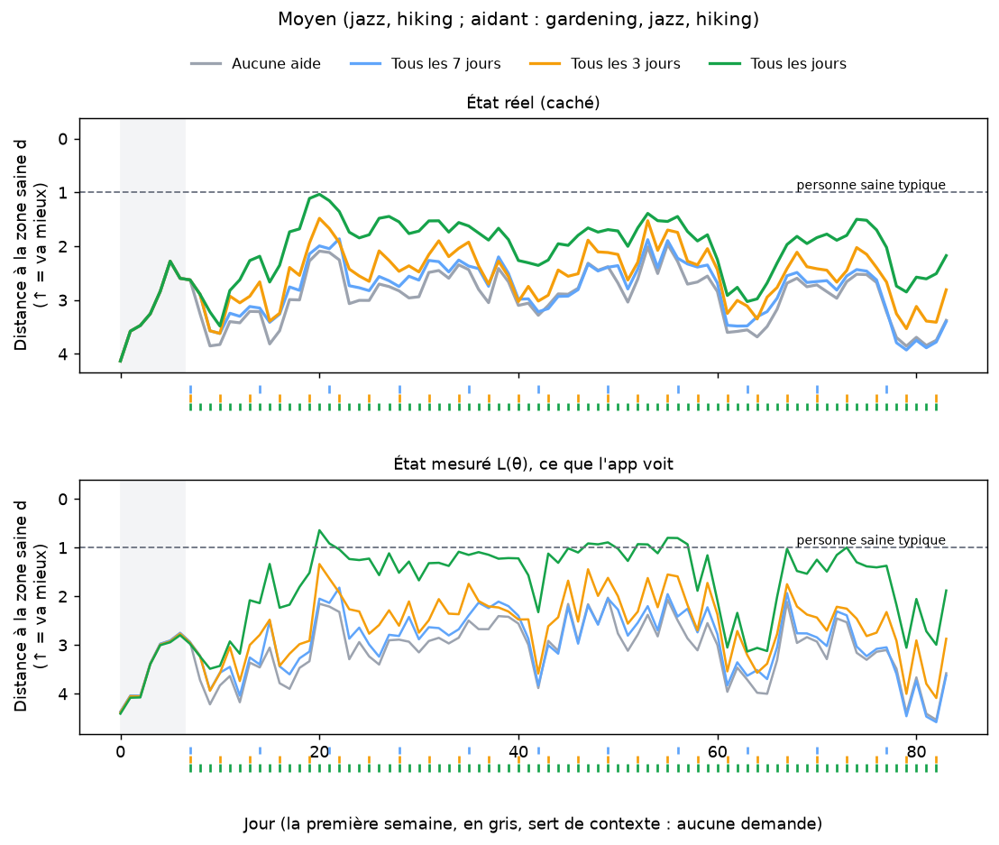
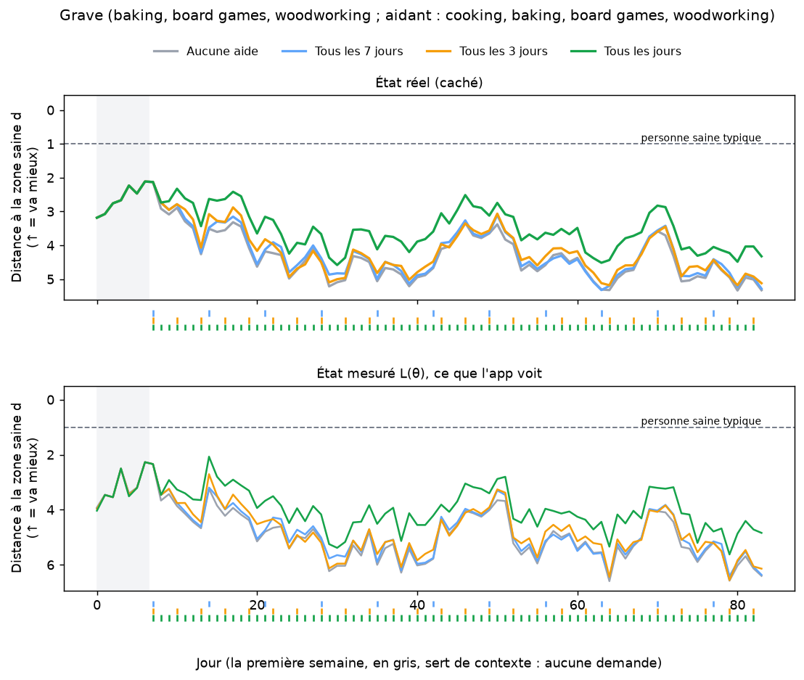

# Rapport de bout en bout

100 patients simulés jamais vus (graine 2026), 84 jours, poids de `ml/weights`. Tout est simulé : ces chiffres disent si la machinerie fait ce qu'on attend d'elle sur le simulateur, pas ce qu'elle ferait avec de vrais patients.

## 1. Appariement

- 100 couples formés, score moyen **0.88** contre **0.41** au hasard.
- 97 % des couples partagent au moins un intérêt mot pour mot.
- 69 % des patients ont l'aidant qui leur convient le mieux à eux seuls (les autres le cèdent à un patient qui en a plus besoin).

| Couple au | Score | Intérêts du patient | Intérêts de l'aidant |
|---|---|---|---|
| 1er quartile | 0.79 | cycling, hiking, woodworking | baking, hiking, cycling |
| Médiane | 1.00 | jazz, board games, baking, hiking | board games, baking, jazz, hiking |
| 3e quartile | 1.00 | jazz, board games, baking, hiking | board games, baking, jazz, hiking |

## 2. Convergence des modèles

6060 demandes envoyées par le réseau B à 100 patients jamais vus. Pour chacune, ce que A prédisait au moment de l'envoi, contre ce qui s'est passé.

| Récompense | Corrélation | Erreur de A | Erreur d'une constante | Réelle, cinquième préféré par A | Réelle, cinquième déconseillé |
|---|---|---|---|---|---|
| Mesurée sur L (ce que A apprend) | 0.36 | 25.2 | 26.9 | 65.3 | 37.4 |
| Réelle, sur l'état caché | 0.25 | 14.3 | 9.1 | 62.6 | 55.9 |

- **Réponse du patient** : AUC 0.57 (0,5 = hasard, 1 = parfait). Taux prévu 92 %, observé 91 %.
- **Autoencodeur**, erreur entre L(θ) et l'état caché (0 à 1) : sleep 0.073, rhythm 0.125, energy 0.079, calm 0.065, activity 0.068, engagement 0.077 ; moyenne 0.081.

## 3. Bien-être selon le délai entre deux aides

Sans aide, le patient suit sa trajectoire naturelle générée. Avec aide, chaque demande est écrite comme dans l'app : zone du réseau B, textes du générateur pour les intérêts du couple formé en partie 1, mesure sur les six axes, choix par `select_three`. Le patient simulé réagit au texte envoyé. Entre deux demandes, l'état suit la trajectoire naturelle, et l'effet des demandes passées s'estompe d'un quart par jour.

Trois types de patients, 5 patients chacun, choisis autour des centiles de gravité 10 (presque guéri), 50 (moyen) et 90 (grave) de leur trajectoire naturelle. Délais testés : 1, 2, 3, 5, 7, 14 jours, et aucune aide. Mêmes tirages pour tous les délais : seule l'aide change.

Générateur utilisé : **offline**. Demandes prévues sans aucune demande générée dans la zone (rien n'est alors envoyé) : 1118 sur 2595.

Ordonnée : la distance à la zone saine, d. Une personne saine typique est autour de 1. **L'axe est retourné : plus la courbe monte, mieux le patient va.**

| Type | Délai | Demandes prévues | Envoyées | Bloquées : coût / intérêts | d réel, 4 dernières semaines | Gain réel contre aucune aide | d mesuré, 4 dernières semaines |
|---|---|---|---|---|---|---|---|
| Presque guéri | Aucune aide | 0 | 0 | 0 / 0 | 1.57 ± 0.36 | — | 1.64 ± 0.62 |
| Presque guéri | Tous les jours | 76 | 30 | 0 / 46 | 1.44 ± 0.23 | +0.13 | 1.20 ± 0.32 |
| Presque guéri | Tous les 2 jours | 38 | 14 | 0 / 24 | 1.47 ± 0.33 | +0.10 | 1.39 ± 0.48 |
| Presque guéri | Tous les 3 jours | 26 | 8 | 0 / 18 | 1.55 ± 0.33 | +0.02 | 1.57 ± 0.59 |
| Presque guéri | Tous les 5 jours | 16 | 5 | 0 / 11 | 1.54 ± 0.32 | +0.03 | 1.56 ± 0.57 |
| Presque guéri | Tous les 7 jours | 11 | 3 | 0 / 8 | 1.56 ± 0.35 | +0.01 | 1.62 ± 0.62 |
| Presque guéri | Tous les 14 jours | 6 | 2 | 0 / 4 | 1.57 ± 0.36 | +0.00 | 1.63 ± 0.62 |
| Moyen | Aucune aide | 0 | 0 | 0 / 0 | 2.90 ± 0.24 | — | 3.45 ± 0.35 |
| Moyen | Tous les jours | 76 | 63 | 0 / 13 | 2.03 ± 0.26 | +0.87 | 2.33 ± 0.35 |
| Moyen | Tous les 2 jours | 38 | 33 | 0 / 5 | 2.50 ± 0.19 | +0.40 | 2.93 ± 0.33 |
| Moyen | Tous les 3 jours | 26 | 22 | 0 / 4 | 2.55 ± 0.12 | +0.35 | 3.01 ± 0.25 |
| Moyen | Tous les 5 jours | 16 | 14 | 0 / 2 | 2.73 ± 0.24 | +0.17 | 3.24 ± 0.32 |
| Moyen | Tous les 7 jours | 11 | 10 | 0 / 1 | 2.76 ± 0.19 | +0.14 | 3.28 ± 0.26 |
| Moyen | Tous les 14 jours | 6 | 6 | 0 / 0 | 2.85 ± 0.23 | +0.05 | 3.39 ± 0.33 |
| Grave | Aucune aide | 0 | 0 | 0 / 0 | 5.27 ± 0.36 | — | 6.16 ± 0.58 |
| Grave | Tous les jours | 76 | 35 | 0 / 41 | 5.01 ± 0.65 | +0.26 | 5.84 ± 0.94 |
| Grave | Tous les 2 jours | 38 | 19 | 0 / 19 | 5.13 ± 0.50 | +0.14 | 5.99 ± 0.75 |
| Grave | Tous les 3 jours | 26 | 13 | 0 / 13 | 5.23 ± 0.42 | +0.04 | 6.12 ± 0.66 |
| Grave | Tous les 5 jours | 16 | 8 | 0 / 8 | 5.20 ± 0.40 | +0.06 | 6.08 ± 0.64 |
| Grave | Tous les 7 jours | 11 | 6 | 0 / 5 | 5.23 ± 0.37 | +0.04 | 6.12 ± 0.60 |
| Grave | Tous les 14 jours | 6 | 3 | 0 / 3 | 5.25 ± 0.37 | +0.01 | 6.15 ± 0.59 |

Gain réel : de combien d baisse par rapport à aucune aide (positif = le patient va mieux). « ± » : écart-type entre les patients du type. Bloquées : demandes prévues qui ne sont pas parties, en moyenne par patient. « Coût » : aucun format de demande n'est assez léger pour la zone de B (le coût d'une demande vient de son format, quel que soit le générateur). « Intérêts » : des formats passaient, mais aucun texte généré n'était placé dans l'intervalle voulu entre les intérêts.

### Un patient de chaque type, jour après jour

En haut, l'état réel (caché, la vérité du simulateur) ; en bas, l'état mesuré L(θ), ce que l'app voit. Chaque trait vertical sous un graphe est une demande envoyée.

### Les premières demandes envoyées au patient moyen, tous les 3 jours

| Jour | Format | Positions (intérêts, concret, durée, échange, exposition, démarrage) | Texte |
|---|---|---|---|
| 7 | explain | 0.68, 0.65, 0.40, 0.40, 0.30, 0.08 | Could you explain what makes swing feel like swing? A voice note is great. Asking in the middle of some gardening. |
| 10 | explain | 0.68, 0.65, 0.40, 0.40, 0.30, 0.08 | In the middle of some gardening: could you explain what makes swing feel like swing? A voice note is great. |
| 13 | explain | 0.68, 0.65, 0.40, 0.40, 0.30, 0.08 | Could you explain what makes swing feel like swing? A voice note is great. Asking in the middle of some gardening. |
| 16 | explain | 0.68, 0.65, 0.40, 0.40, 0.30, 0.08 | Resting after a hike: could you explain what makes swing feel like swing? A voice note is great. |
| 19 | explain | 0.68, 0.65, 0.40, 0.40, 0.30, 0.08 | Resting after a hike: could you explain what makes swing feel like swing? A voice note is great. |
| 22 | explain | 0.68, 0.65, 0.40, 0.40, 0.30, 0.08 | Could you explain what makes swing feel like swing? A voice note is great. Asking in the middle of some gardening. |
