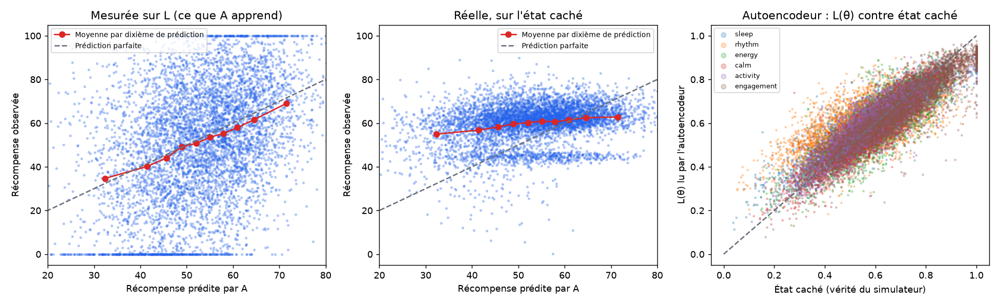
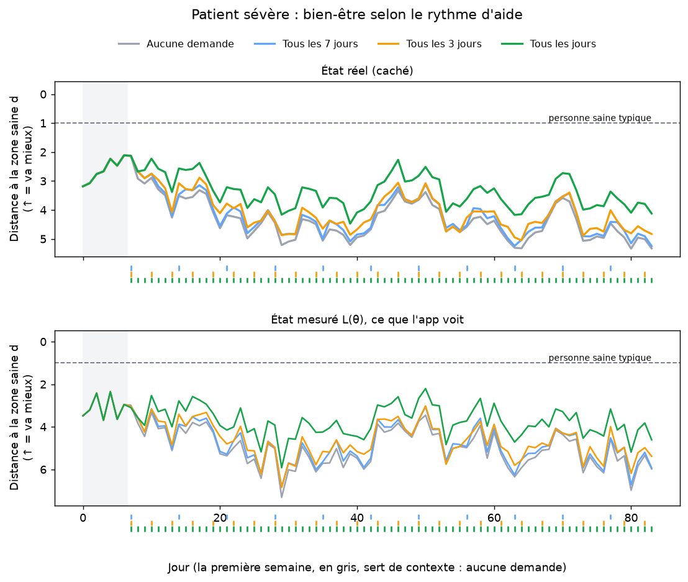
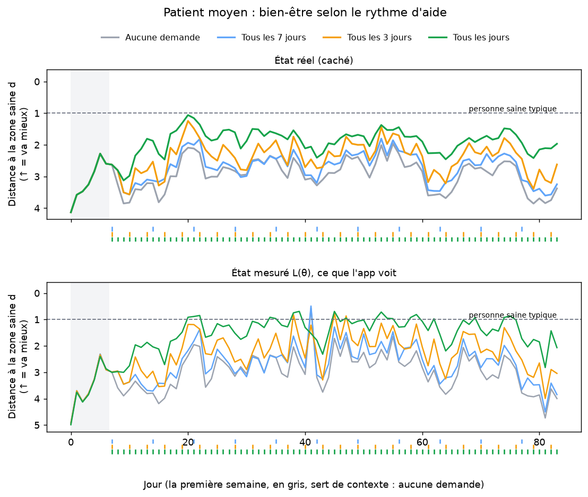
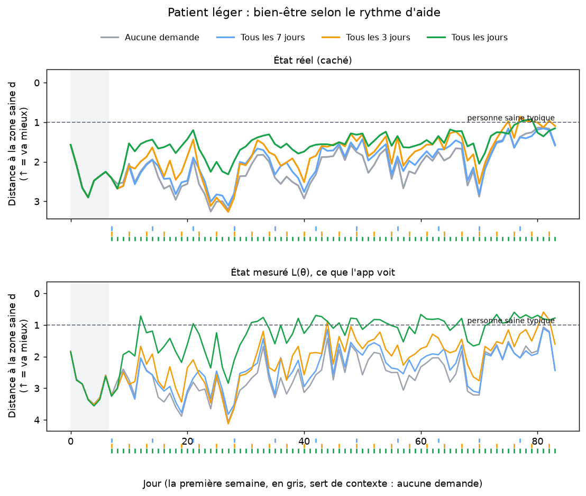

# Rapport de bout en bout

100 patients simulés jamais vus (graine 2026), 84 jours, poids de `ml/weights`. Tout est simulé : ces chiffres disent si la machinerie fait ce qu'on attend d'elle sur le simulateur, pas ce qu'elle ferait avec de vrais patients.

## 1. Appariement

- 100 couples formés, score moyen **0.72** contre **0.23** au hasard.
- 94 % des couples partagent au moins un intérêt mot pour mot.
- 49 % des patients ont l'aidant qui leur convient le mieux à eux seuls (les autres le cèdent à un patient qui en a plus besoin).

| Couple au | Score | Intérêts du patient | Intérêts de l'aidant |
|---|---|---|---|
| 1er quartile | 0.54 | jazz, video games, films, drawing | video games, drawing |
| Médiane | 0.73 | sewing, pottery | drawing, pottery, painting |
| 3e quartile | 1.00 | photography, drawing | podcasts, drawing, photography, video games |

## 2. Convergence des modèles

6060 demandes envoyées par le réseau B à 100 patients jamais vus. Pour chacune, ce que A prédisait au moment de l'envoi, contre ce qui s'est passé.

| Récompense | Corrélation | Erreur de A | Erreur d'une constante | Réelle, cinquième préféré par A | Réelle, cinquième déconseillé |
|---|---|---|---|---|---|
| Mesurée sur L (ce que A apprend) | 0.36 | 25.2 | 26.9 | 65.3 | 37.4 |
| Réelle, sur l'état caché | 0.25 | 14.3 | 9.1 | 62.6 | 55.9 |

- **Réponse du patient** : AUC 0.57 (0,5 = hasard, 1 = parfait). Taux prévu 92 %, observé 91 %.
- **Autoencodeur**, erreur entre L(θ) et l'état caché (0 à 1) : sleep 0.073, rhythm 0.125, energy 0.079, calm 0.065, activity 0.068, engagement 0.077 ; moyenne 0.081.

## 3. Bien-être dans le temps

Ordonnée : la distance à la zone saine, d. Une personne saine typique est autour de 1. **L'axe est retourné : plus la courbe monte, mieux le patient va.** En haut, l'état réel (caché, la vérité du simulateur) ; en bas, l'état mesuré L(θ), ce que l'app voit. Chaque trait vertical en bas d'un graphe est une demande. Mêmes tirages pour les quatre rythmes : seule l'aide change.

| Patient | Rythme | d réel, 4 dernières semaines | d mesuré, 4 dernières semaines |
|---|---|---|---|
| Patient sévère | Aucune demande | 4.69 | 5.31 |
| Patient sévère | Tous les 7 jours | 4.53 | 5.11 |
| Patient sévère | Tous les 3 jours | 4.38 | 4.90 |
| Patient sévère | Tous les jours | 3.60 | 3.89 |

| Patient moyen | Aucune demande | 3.09 | 3.16 |
| Patient moyen | Tous les 7 jours | 2.83 | 2.82 |
| Patient moyen | Tous les 3 jours | 2.50 | 2.32 |
| Patient moyen | Tous les jours | 1.95 | 1.44 |

| Patient léger | Aucune demande | 1.79 | 2.19 |
| Patient léger | Tous les 7 jours | 1.72 | 2.08 |
| Patient léger | Tous les 3 jours | 1.46 | 1.64 |
| Patient léger | Tous les jours | 1.37 | 0.97 |

